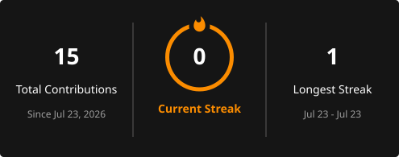

 

---

## 🧑‍💻 About Me

I like figuring things out the hard way first: solve it myself, then hunt for a better approach and refine it. I'm focused on building real, working software instead of textbook examples.

<table>
<tr>
<td width="50%" valign="top">

### 🎓 Education
**BSCS** · Minhaj University Lahore

### 🔭 Currently Practicing
- Object-Oriented Programming
- Data Structures & Algorithms
- Database Design
- Problem Solving

</td>
<td width="50%" valign="top">

### 🚀 Interests
- Software Development
- Databases
- Practical, hands-on projects

### 🌱 How I Learn
Build → break → debug → refine

</td>
</tr>
</table>

---

## 🛠️ Tech Stack

---

## 🎯 Goals

| | |
|---|---|
| 🏗️ Build practical software projects | 🧱 Strengthen programming fundamentals |
| 🧬 Master OOP and Data Structures | 🧩 Improve problem-solving skills |
| 🌍 Contribute to open-source | |

---

## 📊 GitHub Stats

  

 

---

## 🌐 Let's Connect

📫 Always open to collaborating on interesting projects, so reach out!

⭐ Thanks for visiting my profile!

